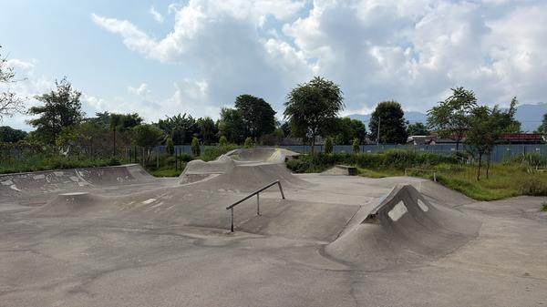

# IST Part 2  
  
  
During IST, I had the opportunity to visit a few different religious sites.  
  
## pashupatinath temple  
A large Hindu temple in Kathmandu, I was unfortunately not allowed to actually enter the temple myself as a non-Hindu. We still had a chance to walk around the complex, see many of the buildings from the outside, as well as a few different religious ceremonies.   
  
  
This is part of a Hindu puja, or prayer / worship. Puja comes in many forms at different times - at home some families perform a small puja daily, visiting small temples in the community (most areas have a small and worshipping one or more deities. At temples such as this, larger pujas are performed regularly. Pashupatinath is dedicated to a manifestation of Shiva, one of the most prominent gods in Hinduism.  
  
  
Pashupatinath sits along the Bagmati River through Kathmandu. If you go later in the evening or night, the lights reflect off the water in a really beautiful way. On that bridge in the right of the picture there are some dudes who hang out and try to give you tika (a spot of red powder in the center of your forehead) and then will request money. I’m still not quite sure if people consider this a sort of scam or not. I’ve received tika on many occasions since coming to Nepal and have not yet paid for it.   
  
  
This photo angle is a popular one for the temple - my picture looks pretty similar to the one you’ll see on the temple’s [wikipedia page.](https://en.wikipedia.org/wiki/Pashupatinath_Temple?wprov=sfti1)   
  
  
  
  
  
Many a cow roaming about freely. For those unaware, cows are considered sacred in hinduism. they can basically do whatever they want here without repercussion.   
  
  
monkeys, conversely, are less sacred here. They are more or less considered nuisances. I’ve been told that if you make eye contact with them, they are more likely to attack. They’re funny little guys though, and fun to watch. I have yet to be attacked by one, but have heard some unpleasant stories from other PCVs.   
  
  
Pashupatinath features several of these structures for performing cremation, called ghats. Following ancient tradition, they burn bodies here and sweep the ashes into the river. I thought they may have been performing one today, but on closer inspection it was just some logs.  
  
  
This photo was a bit blurry, but you can see many more of the ghats along the river here. Kathmandu sits behind in the distance.  
  

  
  
## swayambhu mahachaitya  
  
Swayambhu is a large Buddhist Stupa at the top of a large hill in Kathmandu. Effectively a huge dome with Buddhas eyes atop, it’s a very powerful thing to witness in person. I swung by here one night during IST to meet up with TJ and his host sister. They greeted me there and gave me a tour of the area, and shared some information about the stupa and Buddhism in general.  
  
  
around the stupa there are a series of metal wheels with prayers etched in the sides, commonly seen at buddhist places of worship. You are meant to spin these wheels clockwise with your right hand, as the mantras etched on them are read from left to right. I don’t know why you are supposed to use your right hand specifically.  
  
  
People can be seen here spinning the prayer wheels as they walk clockwise around the stupa.   
  
  
  
This is a few of the smaller stupas which surround the larger one. I’m still not exactly sure what the difference is, and why there are multiple of varying sizes.   
  
  
  
A slightly wider angle photo of the scene. It was very crowded.  
  
  
  
I didn’t get as many photos of the monkeys as I wanted - they don’t hold still long. Swayambhu is also known to many as “The Monkey Temple”  
  

  
  
The rest of IST itself was uneventful. We flew back from Kathmandu to Pokhara on September 28th, then got stuck in Pokhara for a few days due to poor road conditions, then headed home after that.   
  
  
managed to get a nice photo of the mountains on a free day. Shortly after this those clouds on the right rolled in and covered them back up. I spent the rest of the day after this walking around through Pokhara pretty aimlessly and saw some nice neighborhoods.   
  
  
  
Pokhara actually has a pretty neat little skate park. There’s also a few decent ones in Kathmandu. Generally, skateboarding is not that big in Nepal, but popularity is steadily growing. I swung by this one to kill some time waiting to be released back to site. Right when I was done skating, I got the OK from Peace Corps to head back home to Gorkha.   
  

  
  
That’s all for this one. As always, thanks for reading, and I hope you have a great day. Here’s one more monkey.   
  
  
*~ Basanta*  
