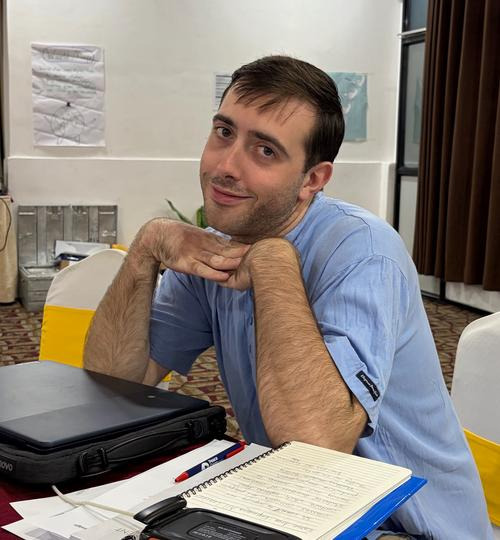

# IST  
  
I started writing this post a few weeks ago, but never quite wrapped it up until now. I’m not going to go through and rephrase everything, so pardon me if it seems a little bit disjointed.   
  
It’s September 24th at 1:33 AM. I just spoke with TJ for a long while about the Mandelbrot Set. The Mandelbrot Set is a popular pattern from the complex plane, the plane of numbers that can be defined via two parts, a real part, and an imaginary part. when given a number comprising these parts, then plugging it into a simple function (fc(z) = z^2 + c) recursively, it will either diverge to infinity or converge towards a single limit. The graph is color coded depending on whether it diverges, and if so how long it takes to do so. It’s pretty neat, and has a lot of really cool looking fractals as you zoom in. See a video of it [here](https://www.youtube.com/watch?v=b005iHf8Z3g).  
  
  
*This photo stolen from somewhere online.*  
  

  
  
This week we are at IST, or “in service training”. This is something that all Peace Corps Volunteers will be familiar with, but usually occurs earlier in service than ours has. Ours was offset slightly due to a combination of monsoon season and splitting of IST by sector (Education went last - Agriculture and Environment sectors went before us).  
  
With a flight to Kathmandu on Friday, the other education volunteers and I headed to Pokhara on Thursday to meet up and prepare to head over. We turned in fairly early to catch our 10 AM flight the next day.   
  
Unfortunately our 10 AM flight was secretly a 1 PM flight in disguise. I’ve been informed this kind of delay is pretty standard for the Pokhara Airport. I spent the free time chit chatting with the other volunteers and playing [Chrono Trigger](https://en.wikipedia.org/wiki/Chrono_Trigger). Eventually we were released to board the plane. Everyone was pretty ready to get moving by this point.   
  
  
*This is Leo, another teacher from my district. *  
  
  
*I thought it was cool that the plane had propeller engines.*  
  
  
*Pokhara Airport *  
  
  
*A view of Kathmandu as we approached. Pokhara, despite being the second largest city in Nepal, is significantly smaller than Kathmandu (600k people vs 1.5 million in Kathmandu). *  
  
*
*  
  
It’s funny to think about how long I’ve been here now. I’ve currently been in Nepal for about 8 and a half months, which is no small chunk of time. My language has improved, I’ve made many new friends, and I feel significantly more confident in my ability to teach. It can be easy to miss these things day to day, but when you get everyone together and look back it’s nice to think about the progress you’ve made.   
  
The first half of IST was largely sessions between the Education volunteers and the Peace Corps staff for the Education sector. Each volunteer gave a small presentation about their site and what sort of things they are doing to improve their community. These presentations ran significantly longer than intended, as everyone took the 15 minute limit for their presentation as more of a suggestion than a hard rule. It was fun though, seeing a detailed look at everyone’s sites. Everyone approaches the work from a slightly different angle. Some are more engaged in the cultural aspects, whereas others take a much more technical approach to teaching. No strategy is better or worse than any other, it’s more of a reflection of what each individual volunteer values the most.   
  
  
*Leo being an angel as usual. I just realized I’ve never asked anyone’s permission to put their photo in my blog. Leo, if you’re reading this, I’d like to request to put this picture in my blog. Thanks.*  
  
  
*TJ delivering an expertly crafted presentation about his site.*  
  

  
  
During the day, IST was really just a lot of hanging out in the hotel with the other education volunteers. It doesn’t make for particularly thrilling content, to be honest. After sessions I spent a bit more time exploring Kathmandu. I’m just going to dump a bunch of photos of that here, of varying quality. Since there’s a lot to cover for IST, I’m also going to split this into two posts, and cover the rest in the next one.  
  
  
*I can’t lie, I’m such a sucker for these narrow shopping ways through the city. They remind me a bit of Akihabara, Tokyo, Japan, but with less technology and more fake Nike shoes.*  
  
  
*A photo I took out the window of an indrive, which is the Nepali equivalent of uber. *  
  
  
*On my way to Swayambhu (which you can see peeking out at the top), a Buddhist stupa that I will cover in the next blog post.*  
  
  
*A Nepali tailor. Me and several of the other volunteers got fitted at a shop much like this one (though not this one specifically) for our teacher uniforms. I wasn’t there at the time, but apparently one of my fellow volunteers didn’t think to ask for a changing room, and just took off all his clothes right there in the shop.*  
  
  
*A rainy day in Kathmandu.*  
  
  
*I can’t recall the name of this place, but I like yellow Vespas and this place had really good buff sliders.*  
  
  
*This car looked cool so my buddy wanted his picture taken in front of it. This one came out kind of blurry. Technically I should probably blur this guy’s license plate but I don’t think anyone reading my blog has any nefarious intentions in mind, and even if you do there’s a good chance you can’t read it anyway.*  
  
That’s all for this one. I should have a lot of free time this week, as Dashain has just begun, a multi-week long holiday here in Nepal. Today was our last day of school before the holiday. I’ll detail more about the rest of IST and my arduous journey home in the next one.  
  
As always, thanks for reading. I hope you’re having a great day wherever you are.   
  
- Basanta  
